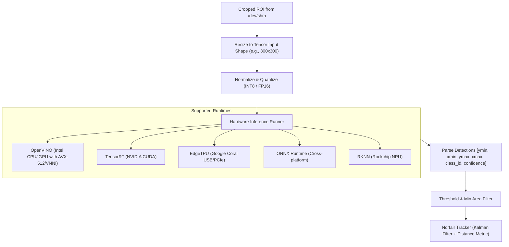
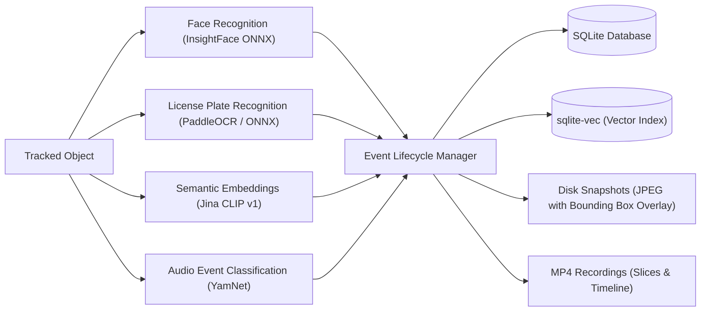
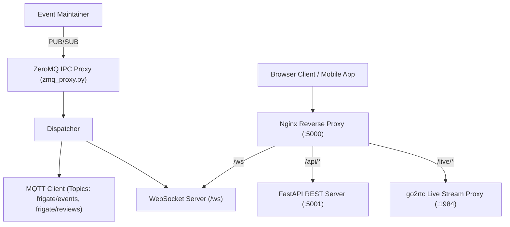
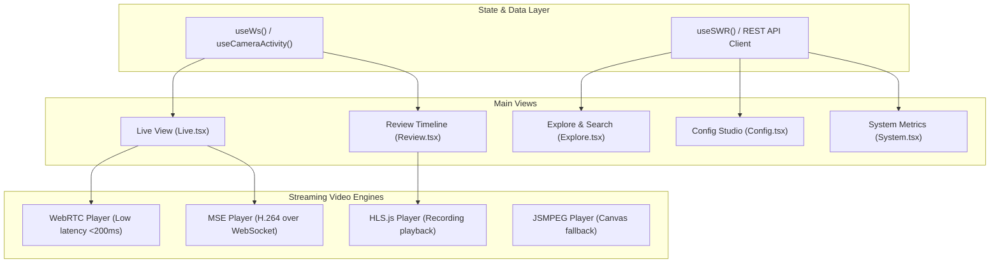

# Frigate NVR Deep-Dive Architecture Guide

This document provides a comprehensive, end-to-end technical explanation of how **Frigate NVR** operates—from raw camera byte ingestion to OpenCV motion filtering, AI detector execution, event database management, and browser-side React rendering.

---

## 1. Architectural Overview & Design Philosophy

Frigate is built with a **high-throughput, low-latency multiprocessing architecture** in Python to circumvent Python's Global Interpreter Lock (GIL) and maximize resource efficiency on edge hardware (CPUs, integrated GPUs, Coral TPUs, and NVIDIA GPUs).

```mermaid
flowchart TD
    subgraph Capture["1. Ingestion & Pre-AI (Zero-Copy)"]
        CAM["IP Cameras / RTSP / Video Files"] -->|H.264 / H.265 / RTSP| GO2RTC["go2rtc / FFmpeg Process"]
        GO2RTC -->|Raw YUV420p Frame Buffers| SHM["POSIX Shared Memory (/dev/shm)"]
        SHM -->|Downscaled Grayscale Frame| CV["OpenCV Motion Engine (improved_motion.py)"]
        CV -->|Motion Contours| REG["Region Calculator (Bounding Box + Padding)"]
    end

    subgraph Inference["2. AI Inference & Tracking"]
        REG -->|Cropped ROI Tensor (e.g. 300x300)| DET["Hardware AI Detector (OpenVINO / TensorRT / Coral)"]
        DET -->|Detected Boxes [x, y, w, h, class, score]| TRACK["Object Tracker (Norfair / Kalman Filter)"]
    end

    subgraph Secondary["3. Post-Processing & Persistence"]
        TRACK --> SEC["Secondary Models (Face / LPR / CLIP)"]
        TRACK --> EVT["Event Maintainer & Timeline Manager"]
        SHM --> REC["Recording Slicer (10s MP4 Segments)"]
        EVT --> DB[("SQLite Database + sqlite-vec")]
    end

    subgraph Comms["4. Dispatch & IPC"]
        EVT --> ZMQ["ZeroMQ Proxy & InterProcess Communicator"]
        ZMQ --> WS["WebSocket Server (/ws)"]
        ZMQ --> MQTT["MQTT Broker (Home Assistant Integration)"]
    end

    subgraph Frontend["5. Frontend (React 18 / Vite / Tailwind)"]
        WS --> UI_HOOKS["React WebSocket & State Hooks"]
        GO2RTC -->|WebRTC / MSE Stream| PLAYER["Video Player Component (Live View)"]
        DB -->|FastAPI REST API| UI_VIEWS["Live Grid / Review Timeline / Explore"]
    end
```

---

## 2. Phase 1: Ingestion & Pre-AI Pipeline (Everything Before AI)

Before any neural network executes, Frigate processes video streams to avoid wasting CPU/GPU compute on static frames.

```mermaid
flowchart LR
    RTSP["RTSP Stream"] --> FF["FFmpeg"]
    FF -->|Decode to YUV420p| SHM["Shared Memory Frame Buffer"]
    SHM --> GRAY["Convert to Grayscale (300px)"]
    GRAY --> BLUR["Gaussian Blur (cv2.GaussianBlur)"]
    BLUR --> DIFF["Frame Differencing (cv2.absdiff)"]
    DIFF --> THRESH["Threshold & Dilate (cv2.threshold / dilate)"]
    THRESH --> MASK["Apply Motion Masks (Ignore trees/stamps)"]
    MASK --> BOX["Extract Bounding Rects (cv2.findContours)"]
    BOX --> ROI["Calculate Region of Interest (ROI)"]
```



### Step-by-Step Pre-AI Pipeline:

1. **Stream Ingestion (`frigate/video/detect.py`, `frigate/ffmpeg_presets.py`)**:
   - `go2rtc` and `ffmpeg` processes pull RTSP/H.264/H.265 video packets.
   - FFmpeg splits the stream into two roles:
     - **Record Role**: Direct stream copy (`-c:v copy`) to disk cache without re-encoding.
     - **Detect Role**: Decoded raw video output formatted as `rawvideo yuv420p` at a configured detection frame rate (default: 5 fps).
2. **Zero-Copy Shared Memory (`/dev/shm`)**:
   - Raw decoded YUV frames are written directly to POSIX shared memory ring buffers (`UntrackedSharedMemory`).
   - Other processes read frame memory pointers directly without serializing or copying frame bytes across process boundaries.
3. **Motion Detection with OpenCV (`frigate/motion/improved_motion.py`)**:
   - **Downscaling**: The frame is downsampled to a motion grid resolution (typically width $\approx 300\text{px}$) to minimize matrix calculation overhead.
   - **Grayscale Conversion (`cv2.cvtColor`)**: Color data is stripped, keeping only the luminance ($Y$) channel.
   - **Gaussian Blur (`cv2.GaussianBlur`)**: Blurs high-frequency digital noise and compression artifacts.
   - **Background Differencing (`cv2.absdiff`)**: Calculates pixel delta between the current frame and an exponential moving average background model.
   - **Binary Thresholding (`cv2.threshold`) & Dilation (`cv2.dilate`)**: Converts pixel deltas to a binary motion mask and dilates pixels to bridge adjacent moving areas.
   - **Motion Mask Subtraction (`cv2.bitwise_and`)**: Subtracts user-configured motion masks (ignoring timestamps, swaying tree branches, flags).
   - **Contour Finding (`cv2.findContours`, `cv2.boundingRect`)**: Groups contiguous moving pixels into bounding boxes.
4. **Region of Interest (ROI) Calculation**:
   - If motion contours exist, Frigate calculates an expanded bounding box that incorporates:
     - 20% margin padding around moving objects.
     - Aspect ratio squaring to match detector input dimensions (e.g. $300\times300$ or $640\times640$).
   - **If no motion is detected, the AI detector is never called**, saving over 90% of host compute.

---

## 3. Phase 2: AI Inference & Object Tracking

When motion is detected, the cropped region of interest is sent to the hardware detector.



### Step-by-Step AI Execution:

1. **Tensor Preparation (`frigate/detectors/detection_runners.py`)**:
   - Crops the ROI directly from shared memory.
   - Resizes via bilinear interpolation to match the model input tensor (e.g. $300\times300$ for MobileNet, $640\times640$ for YOLO).
   - Formats tensor into `NCHW` or `NHWC` layout and normalizes pixels if required.
2. **Inference Execution**:
   - The detector plugin passes the tensor to the underlying hardware runtime (e.g. OpenVINO runtime utilizing AVX-512 VNNI instructions).
   - Returns bounding boxes, class labels, and confidence scores.
3. **Temporal Tracking with Norfair (`frigate/track/norfair_tracker.py`)**:
   - Single-frame detections are matched against historical trajectories using a **Kalman filter**.
   - Assigns persistent `object_id` across frames.
   - Classifies **Stationary Objects**: If a detected car parks and stops moving, Frigate transitions it to a stationary state to prevent redundant detector triggering.
4. **Zone Evaluation (`frigate/config/camera/zone.py`)**:
   - Runs point-in-polygon checks to determine if the bottom-center of the object bounding box lies inside user-defined polygons (`road_zone`, `walkway_zone`).

---

## 4. Phase 3: Post-AI Secondary Processing & Storage

Once an object is tracked, secondary analysis pipelines extract contextual details:



1. **Face Recognition (`frigate/data_processing/real_time/face.py`)**:
   - Crops detected person heads and extracts 512-dimensional facial embeddings using MobileFaceNet/InsightFace.
   - Matches embeddings against registered faces to label persons.
2. **License Plate Recognition (`frigate/data_processing/post/license_plate.py`)**:
   - Detects vehicle bumper/plate regions and executes text OCR to extract alphanumeric plate numbers.
3. **Semantic Vector Search (`frigate/embeddings/embeddings.py`)**:
   - Generates text and vision embeddings using **Jina CLIP v1**.
   - Writes vectors into `sqlite-vec`, enabling natural language search queries (e.g., *"delivery truck in driveway"*).
4. **Event Lifecycle & Persistence (`frigate/events/maintainer.py`)**:
   - Creates database records (`Event`, `Timeline`, `ReviewSegment`).
   - Saves high-resolution snapshot images with optional bounding box and timestamp overlays.
   - Manages recording retention policies (e.g., retain 24/7 for 3 days, retain active motion events for 14 days).

---

## 5. Phase 4: Backend Communication & API Layer

Frigate links its multiprocessing backend with external clients via high-performance messaging protocols:



- **ZeroMQ (ZMQ)**: High-speed inter-process communication bus connecting capture processes, detector processes, and the event supervisor.
- **FastAPI Backend (`frigate/api/`)**: Provides REST endpoints for camera configuration, event history, timeline scrubbing, statistics, and PTZ controls.
- **WebSocket Gateway (`frigate/comms/ws.py`)**: Broadcasts real-time detection events, camera metrics, and live state updates to connected frontends.
- **MQTT Bridge (`frigate/comms/mqtt.py`)**: Publishes state topics and Home Assistant Auto-Discovery payloads.
- **Nginx (`docker/main/rootfs/etc/nginx/`)**: Front-facing proxy listening on port 5000 that routes REST queries to FastAPI, WebSocket connections to Python WS servers, and WebRTC handshakes to `go2rtc`.

---

## 6. Phase 5: Frontend Architecture (Everything in the Frontend)

The user interface is a single-page application (SPA) built with modern web technologies:

### Frontend Technology Stack:
- **Framework**: React 18 with TypeScript.
- **Build Tool**: Vite with SWC compilation.
- **Styling**: TailwindCSS with `cn()` utility and custom HSL color tokens.
- **UI Components**: Radix UI Primitives (dialogs, dropdowns, tooltips, tabs, sliders).
- **Icons**: Lucide React.
- **Code Editor**: Monaco Editor with YAML validation plugin.
- **Internationalization**: `react-i18next`.



### Key Frontend Views & Mechanisms:

1. **Live Dashboard (`web/src/views/live/LiveView.tsx`)**:
   - Renders responsive CSS grids of live camera tiles.
   - Negotiates low-latency WebRTC peer connections with `go2rtc`. If WebRTC is blocked by firewall or network conditions, it automatically falls back to MSE or JSMPEG.
2. **Review & Timeline Scrubber (`web/src/views/review/ReviewView.tsx`)**:
   - Virtualized 24-hour horizontal scrubber that displays motion intensity bars and event severity markers (Alerts vs Detections).
   - Fetches sliced MP4 segments seamlessly via HLS.
3. **Explore / Semantic Search (`web/src/views/explore/ExploreView.tsx`)**:
   - Search bar that accepts natural language queries.
   - Calls `/api/explore` to perform vector similarity lookups against `sqlite-vec`.
4. **Config Studio (`web/src/views/config/ConfigView.tsx`)**:
   - Embedded Monaco YAML editor with real-time Pydantic schema validation, syntax checking, and safe restart triggers.
5. **Debug Bounding Box View (`web/src/views/live/LiveCameraDebug.tsx`)**:
   - Renders live MJPEG debug streams with real-time OpenCV motion regions (blue), AI regions (red), zone polygons (green/yellow), and tracked object bounding boxes.

---

## 7. Technology & Tooling Summary

| Layer | Technology | Primary Function |
| :--- | :--- | :--- |
| **Ingestion** | `go2rtc` & `FFmpeg` | Video protocol translation, RTSP parsing, YUV420 decoding, MP4 slicing. |
| **Shared Memory** | POSIX Shared Memory (`/dev/shm`) | Zero-copy high-throughput frame buffer sharing between processes. |
| **Pre-AI / Motion** | `OpenCV (cv2)` | Grayscale conversion, Gaussian blurring, background differencing, contour detection. |
| **AI Inference** | OpenVINO / TensorRT / Coral / ONNX | Hardware-accelerated quantized neural network inference at the edge. |
| **Tracking** | `Norfair` (Kalman Filtering) | Multi-frame object trajectory association and stationary classification. |
| **Secondary AI** | InsightFace, PaddleOCR, Jina CLIP v1 | Face recognition, license plate OCR, semantic vector embeddings. |
| **Database** | SQLite + `peewee` ORM + `sqlite-vec` | Relational metadata storage and fast vector similarity indexing. |
| **IPC & Messaging** | ZeroMQ & Eclipse Mosquitto (MQTT) | Inter-process signaling, WebSockets dispatch, Home Assistant auto-discovery. |
| **API Server** | FastAPI & Uvicorn | REST endpoints, authentication, configuration validation, export management. |
| **Reverse Proxy** | Nginx | Port 5000 request routing across FastAPI, WebSockets, and `go2rtc`. |
| **Frontend** | React 18, TypeScript, Vite, TailwindCSS | Real-time surveillance UI, WebRTC streaming, and Monaco config editor. |
