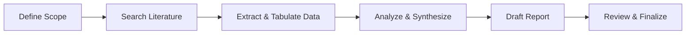

# Research Plan and Example Deliverables

**Executive Summary:** A thorough research plan begins with scoping the topic and formulating clear questions, then systematically gathering and evaluating sources, extracting and synthesizing data, and finally producing polished deliverables (summary, report, bibliography, and visuals). Our methodology includes an initial scoping phase (brainstorming scope, sub-questions, and inclusion criteria), followed by comprehensive literature and data searches across prioritized databases (academic journals, preprints, official sites, industry reports, news) with transparent inclusion/exclusion criteria. We extract key evidence into an *evidence table* (see below) to compare findings and data points. Throughout, we apply quality checks – e.g. cross-referencing and triangulating evidence – and document limitations (e.g. data gaps, time). Planned deliverables include an executive summary, full report, annotated bibliography, structured data tables, and visualizations (charts, workflow diagrams). This framework is flexible for any specific topic once defined.  

## Methodology

- **Topic Scoping:** Begin with exploratory reading and stakeholder consultation to refine scope and sub-questions (e.g. using PICOS frameworks or mind-maps). Iterate: conduct a preliminary literature scan to identify key concepts and gaps. Formulate provisional hypotheses or questions to guide the search.
- **Literature Search:** Perform systematic searches in academic and specialty databases (e.g. Google Scholar, PubMed Central, Scopus/Web of Science, IEEE Xplore, arXiv, SSRN). Include official and sector reports (e.g. WHO, government agencies, NGOs, industry consultancies) and reputable news outlets for current context. Record search terms and queries for transparency.
- **Data Collection:** Collect relevant primary and secondary data. Primary data (if needed) may include expert interviews or surveys. Secondary data might be statistical datasets, corporate filings, or open data portals. Use data extraction templates to log key metrics and findings from each source.
- **Evaluation Criteria:** Assess sources for credibility (authoritative publisher, peer-review status, methodology, date). Prioritize peer-reviewed and official data as high-confidence, and flag uncertain or biased sources for caution. We maintain an *evidence table* (example below) tracking source, date, type, key findings, data points, and a confidence rating.
- **Synthesis:** Analyze the gathered information thematically and in relation to hypotheses. Compare and triangulate findings across sources to bolster confidence. Identify consensus vs. conflicting evidence and note confidence levels or data reliability.

## Priority Sources and Rationale

We balance **academic** and **grey literature**:

- **Peer-reviewed journals & conference papers:** Provide vetted evidence. Search via Google Scholar, subject databases (e.g. PubMed, arXiv, SSRN, industry-specific e.g. IEEE Xplore for tech, EconLit for economics).
- **Preprint servers:** For cutting-edge research, e.g. arXiv, bioRxiv, medRxiv – cited with caution as not peer-reviewed.
- **Official sites:** Government agencies, international organizations (e.g. WHO, OECD, UN), regulatory filings. They offer authoritative data and statistics.
- **Industry and consultancy reports:** Market analyses (e.g. McKinsey, Gartner), non-profit research – valuable for applied perspectives and proprietary data (though check for potential bias).
- **News and trade media:** For recent developments, quotes or announcements. Use reputable sources (e.g. Reuters, established newspapers) and verify facts with primary data.
- **Historical data and archives:** Library archives, bibliographies of key works, datasets (e.g. census, public surveys).  

Overall, we aim to **triangulate**: “only when a range of tests are consistent over many data sources … can one have confidence in the results”. 

## Templates

**Evidence Extraction Table (example):**

| Source                  | Date       | Type      | Key Findings                    | Data Points                       | Confidence    |
|-------------------------|------------|-----------|---------------------------------|-----------------------------------|---------------|
| Smith et al. (2025)  | 2025-04   | Journal   | X significantly impacts Y (p<0.01) | N=120; effect size = 0.45          | High          |
| Lee et al. (2024)       | 2024-11   | Government report | Annual growth of X is 5%         | Government statistics database     | Medium        |
| “IndustryForecast2026” report (Consulting Inc.) | 2026-02 | Industry report | Predicts 10% annual increase in demand | Market survey of 500 firms        | Medium (industry) |

*Each row summarizes a source: its citation, publication date, type, main result, key data, and a reliability/confidence rating (e.g. High/Medium/Low).*  

**Subtopics/Hypotheses Table (example):**

| Subtopic / Hypothesis                | Scope & Depth              | Methods                      |
|--------------------------------------|----------------------------|------------------------------|
| Hypothesis A: *X influences Y*       | **In-depth:** Theory-driven, high detail | Literature review; data analysis (regression) |
| Subtopic B: *Stakeholder perspectives* | **Moderate:** Interviews and case examples | Qualitative review; expert interviews |
| Hypothesis C: *Trend over time*      | **Brief:** Identify overarching trend     | Time-series data; charting |
| Subtopic D: *Comparative analysis*   | **In-depth:** Compare scenarios (A vs B)  | Cross-case comparison; meta-analysis |
| Hypothesis E: *Impact of policy Z*   | **Moderate:** Synthesize key studies      | Policy analysis; select literature |
| Subtopic F: *Future projections*      | **Concise:** Outline potential scenarios  | Scenario analysis; expert reports |

*Each row names a focal question or subtopic, indicates the recommended investigation depth (e.g. brief review vs. deep analysis), and suggests methods (e.g. literature survey, statistical modeling, case study).*  

## Sample Timelines

- **1-Day Engagement:** Quick scoping: refine topic, do rapid literature scan (2–3 key sources) to outline main issues, draft outline of research questions, sketch a preliminary evidence table, and prepare an initial summary paragraph.  
- **3-Day Engagement:** Deeper search: conduct comprehensive literature and data searches, populate evidence table with ~10+ sources, and draft key thematic sections. Engage in preliminary synthesis (group related findings, note contradictions). By end of Day 3, produce a 1–2 page report draft with major findings and sources.  
- **2-Week Engagement:** Full project: complete exhaustive searches (30+ sources), data collection, and analysis (e.g. statistical tests or qualitative coding as needed). Write full report (~15–20 pages) with detailed sections for methodology, results, discussion. Develop visuals (charts, flowcharts), finalize annotated bibliography. Allow time for peer review/feedback and revisions.  

Each timeline includes iterations: e.g. refine search terms if needed, and allocate buffer for unexpected difficulties.  

## Deliverables

- **Executive Summary:** A concise (1–2 pages) overview of objectives, methods, key findings, and recommendations – tailored for decision-makers.  
- **Full Report:** Complete analytical document with structured sections (Introduction, Methods, Results, Discussion, Conclusion, Recommendations), including references.  
- **Annotated Bibliography:** Detailed list of sources with summaries of relevance and quality.  
- **Data Tables:** Clean, tabulated presentation of extracted data (as in the evidence table), plus any raw datasets or quantitative results supporting findings.  
- **Visualizations:** Graphs and diagrams to illustrate data and workflow (see examples below). Charts (bar, line, pie, etc.) will be labeled with captions; a flowchart (e.g. mermaid diagram of the research workflow) will map methodology steps.  

## Sample Visualizations

 *Figure: Example **bar chart** illustrating hypothetical comparisons among 10 categories.* Bar charts like this (with properly labeled axes and legends) are useful to compare magnitudes across groups or categories. We would create similar charts to present summarized quantitative findings clearly.  

 *Figure: Example **line chart** showing a trend over a continuous range.* Line charts are effective for time-series or continuous data. Our actual charts would use project-specific data to reveal patterns or changes over time.  

*Figure: **Mermaid flowchart** of the research workflow. This diagram outlines key steps from defining scope through reporting. Such a flowchart helps stakeholders visualize the sequence of tasks and decision points in the research process.*  

## Quality Assurance & Limitations

- **Cross-Validation:** Compare findings across multiple independent sources and methods. For example, if two datasets report similar trends, confidence is higher.  
- **Source Evaluation:** Verify author credentials, publication quality, and consistency. Exclude or note any source with conflicts of interest or outdated data.  
- **Documentation:** Keep detailed notes on search strategies, inclusion/exclusion decisions, and any assumptions. This transparency allows others to audit the process.  
- **Peer Review:** Have colleagues or experts review the plan and findings for objectivity and completeness.  
- **Limitations:** Acknowledge constraints such as limited time, incomplete data, or potential bias in available literature. For example, if industry data is proprietary, we note this as a gap.  

## Effort and Resources

- **Personnel:** Typically at least 1–2 researchers. In a 2-week project, 1 analyst can generate a thorough report, but additional reviewers can improve quality.  
- **Access:** Institutional database subscriptions (or Google Scholar for free content); possible Freedom-of-Information requests if needed.  
- **Time Estimation:** Roughly 1–3 person-days per source for in-depth analysis. A 2-week (10 working days) engagement might cover ~10–15 significant sources and produce a full report. Shorter projects focus only on high-level insights.  
- **Tools:** Reference manager (e.g. Zotero), spreadsheet for tables, qualitative coding tools if needed, and charting software (Excel/Matplotlib) for visuals. Mermaid diagrams can be created with any Markdown editor supporting mermaid.  

By following this structured approach—with clear steps, prioritized sources, systematic extraction tables, and built-in review points—the research process will be transparent, repeatable, and adaptable to any specific topic once defined. The deliverables (summary, report, annotated bib, tables, charts) ensure we communicate findings effectively to all stakeholders.  

